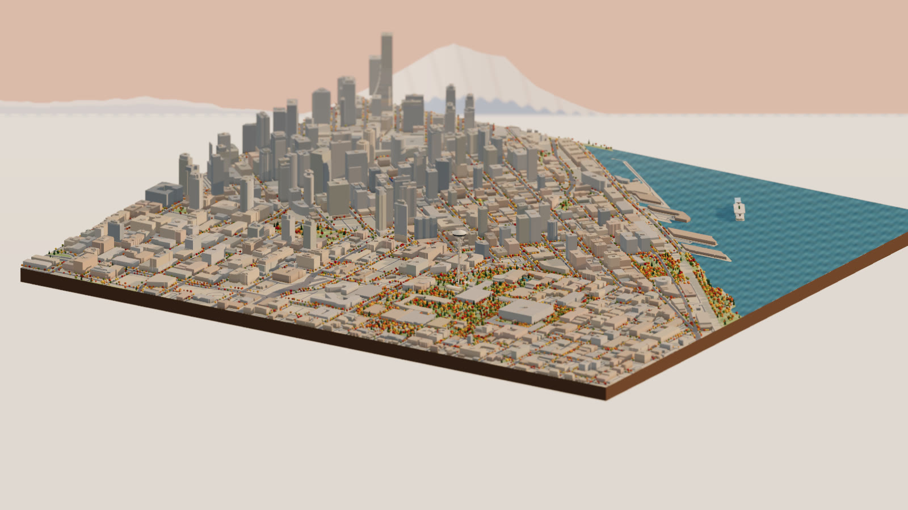
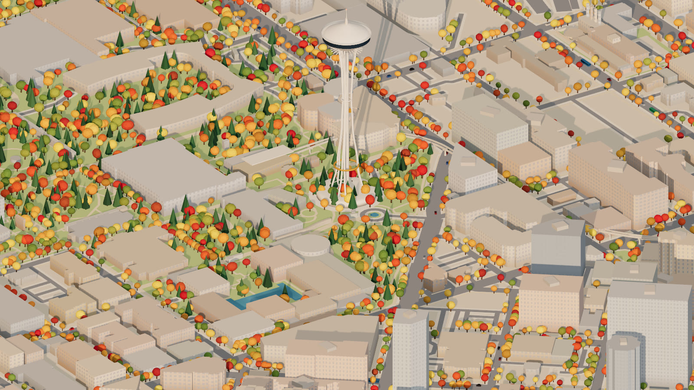
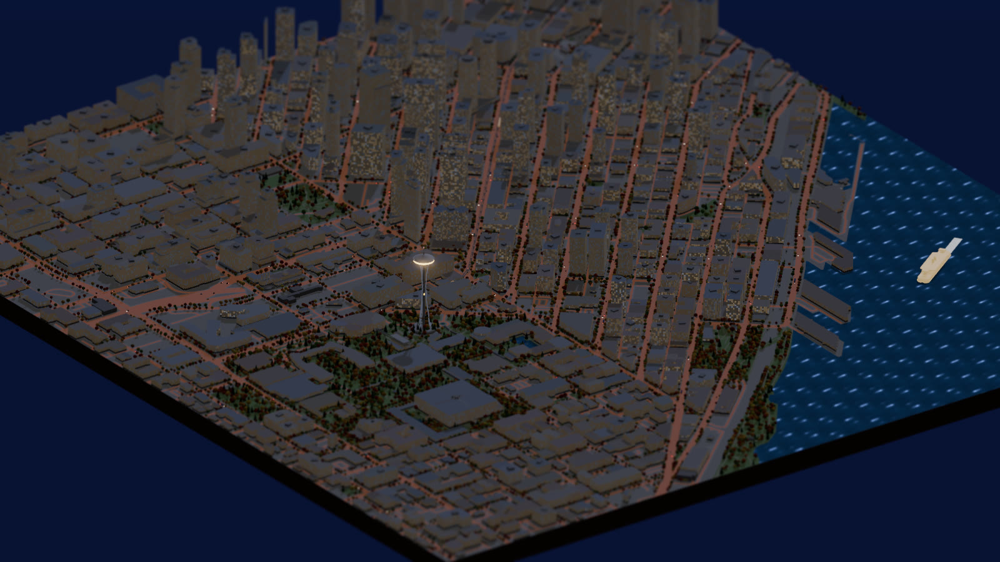

# Seattle Diorama

**[▶ Open the live diorama](https://brooksgroves.com/seattle-diorama/)** · [Read the story](https://brooksgroves.com/blog/seattle-diorama-post.html)

A hand-crafted-looking, fully procedural 3D diorama of Seattle, from the Space
Needle down 5th Avenue to Westlake. It is built entirely from open map data and
a few hundred lines of shader code, and runs at 60 fps in the browser.



## What's in it

- **The real city.** About 1,500 buildings from OpenStreetMap with their mapped
  heights, plus the street grid, the Elliott Bay waterfront and piers, and
  Seattle Center's grounds. A GitHub Action re-pulls the map every week.
- **The Space Needle, built by hand.** Three leg pairs pinch to the waist, with
  the 100-ft halo, a sunburst under the saucer, a glowing restaurant band at
  night and a blinking beacon. Two elevators ride the core on a ~41-second trip,
  like the real ones.
- **The Monorail, running.** The Red and Blue trains run on the actual beams
  between Seattle Center and Westlake. They accelerate, cruise, brake and dwell
  at the stations. Click **Ride along** to follow one.
- **The Westin's twin towers.** The ribbed "corncob" cylinders on 5th Avenue,
  placed from their real OSM footprints.
- **The Spheres.** Amazon's three glass conservatories at 7th & Lenora, with a
  geodesic steel lattice and a cloud forest inside that glows after dark.
- **Olympic Sculpture Park and public art.** The park is kept open meadow down
  to the bay. About 100 pieces of public art mapped in OSM appear as small
  abstract markers on plinths. They show where each piece stands; they are not
  replicas of the works.
- **The mountains.** Rainier rises behind downtown when you face south-east,
  the Olympics stand across the Sound, and Baker sits to the north. The
  panorama turns with the camera and goes rosy at sunset.
- **Seattle weather.** Toggle **Rain** for drizzle, wet streets and a lower
  sky, and **Live sun** to light the city by where the sun really is over
  Seattle right now.
- **Life.** About 8,700 trees in late-October color, cars, Metro buses, and a
  Jumbo Mark II–style Washington State Ferry crossing Elliott Bay. The ferry
  has the green stripe, open car decks, twin pilothouses and stacks, and a
  foam wake.
- **Day to night.** At night the windows light up, the streets glow sodium
  orange and the saucer shines.

| | |
|---|---|
|  |  |

## The Sierra: Yosemite Valley, Tuolumne Meadows, Mono Lake

The same engine also carves three Sierra Nevada places from **USGS 3DEP
elevation** and OpenStreetMap. Pick one with the buttons under the title,
or link straight to it with `?place=yosemite`, `?place=tuolumne` or
`?place=mono`.

- **Yosemite Valley.** El Capitan, Half Dome, Glacier Point and the Merced.
  Seven waterfalls are traced down their real cliffs and matched to their
  real heights, from Upper Yosemite Fall (436 m) to Vernal (97 m). At night
  climbers' headlamps glow on El Cap and Half Dome.
- **Tuolumne Meadows.** Lembert, Pothole and Fairview Domes, Cathedral and
  Unicorn Peaks, and the Tuolumne River winding through golden meadows, with
  cars on Tioga Road.
- **Mono Lake.** The whole lake, with black-cinder Negit (and its gulls) and
  pale Paoha, plus South Tufa's towers and the white band of lakebed exposed
  since the 1940s. The Sierra escarpment rises behind Lee Vining, and traffic
  runs on US 395.

Each place has a **season** toggle and **snow**:

- **Autumn**, the default, is how they look in late October. Gold oaks and
  aspens, tawny meadows, and Yosemite Falls usually dry.
- **Spring snowmelt** greens everything up, puts snow on the rims and makes
  the falls roar.
- **Snow** brings a storm in and lowers the snowline as it falls.

The slabs have layered rock walls, 100 m contour lines (50 m at Tuolumne)
and their own mountain horizons, with Dana and the crest behind Mono Lake.

```bash
pixi run sierra   # fetch elevation + OSM for all three and build them
```

## Quick start

Requires [pixi](https://pixi.sh).

```bash
pixi run city   # download OpenStreetMap for the study area + build the scene
pixi run dev    # open the viewer at http://localhost:5173
```

In the viewer:

- **Drag** to orbit, **right-drag** to pan and **scroll** to zoom. The tilt
  goes all the way from map view to street level.
- **Fly to** the Needle, the Westin, the Spheres or the Sculpture Park, or
  **ride along** with a train.
- **Photo · 4K** saves a still. **Copy link to view** puts the exact camera,
  time and weather in a shareable URL.

If the Overpass API is down, `pixi run demo` builds a synthetic test city so
you can still work on the renderer.

## Making the film

The fly-through is scripted in [`web/src/film.js`](web/src/film.js) as a list of
camera keyframes (target, azimuth, tilt, zoom and time of day). The camera
glides through them on Catmull-Rom splines. The default cut runs 53 seconds:

1. A morning establishing shot.
2. A pass over the Sculpture Park and the bay.
3. A sweep around the Needle.
4. Riding the Red train out of Seattle Center.
5. A look down into the Spheres.
6. An orbit of the Westin at golden hour.
7. A pull back out as the city lights up.

There are two ways to get the video:

- **Quick: record in the browser.** Click **Record video** in the viewer. It
  plays in real time and downloads when it ends.
- **Best: render frame by frame.** This drives a browser with Playwright and
  pipes every frame to ffmpeg, so the video is perfectly smooth on any machine.

  ```bash
  pixi run film-setup                  # once
  pixi run film                        # film/seattle-diorama.mp4, 1080p60
  pixi run film --res 3840x2160        # 4K
  pixi run film --seconds 8 --fps 30   # quick test
  pixi run film --headed               # if headless rendering has no GPU
  pixi run film --place yosemite       # or tuolumne, mono
  ```

  On GitHub: **Actions → Render the film → Run workflow** (choose the place),
  or push to a `render-film-<place>` branch. The film is split across 20
  free machines, and the result lands on the `film` branch.

## How it works

```
OpenStreetMap ──Overpass──▶ fetch.py ──▶ build.py ──▶ scene.json ──▶ Three.js viewer
                                         shapely:                     merged meshes,
                                         project, clip,               window shader,
                                         buffer roads,                instancing,
                                         rebuild the bay              procedural sky
```

**Pipeline** (Python + shapely, [`pipeline/build.py`](pipeline/build.py)):

- **Projection.** Everything is projected to a local meter grid, clipped to the
  study box and simplified.
- **Building heights.** Heights come from `height`, then `building:levels`,
  then a type-based default. When a building is split into `building:part`s,
  the parts are used instead of the outline.
- **Elliott Bay.** Rebuilt by splitting the box along `natural=coastline`;
  OSM keeps land on the left of the line.
- **Roads.** Buffered by class and unioned, with sidewalks as a ring around
  them.
- **Street trees.** Planted along arterials with a seeded generator so the city
  is identical on every build.

**Viewer** (Three.js, [`web/src`](web/src)):

- **Draw calls.** All buildings are one merged mesh, and trees, cars and buses
  are instanced. The whole city is a handful of draw calls.
- **Windows.** They are a shader, not geometry. A procedural grid is driven by
  the distance along each facade and the floor height, anti-aliased with
  `fwidth`, and a random subset lights up at night.
- **Camera.** It is orthographic for the diorama look. Shadows follow the
  view, and the shadow map snaps to texels so it doesn't shimmer.
- **Post-processing.** Bloom for the night glow, tilt-shift for the miniature
  look, and ACES tone mapping.
- **Sky and mountains.** Both are one full-screen shader. The mountain
  panorama is drawn from compass bearings, and the horizon sits behind the far
  edge of the slab.
- **Live sun.** It uses the NOAA solar position algorithm for Seattle.

**CI**: [`.github/workflows/build.yml`](.github/workflows/build.yml) runs on
every push and weekly. It fetches OSM, builds the scene, bundles the viewer and
deploys to GitHub Pages. The built `scene.json` is also kept on the
`scene-data` branch.

## Project layout

```
pipeline/   config.py · fetch.py · build.py · places.py · terrain.py · film.py · make_test_osm.py
web/src/    main.js · places/ (seattle, sierra) · city.js · terrain.js · landmarks.js · life.js · bay.js · weather.js · sky.js · film.js
```

URL parameters: `?place=seattle|yosemite|tuolumne|mono` · `?view=…` (any Fly-to id) · `?season=spring` · `?t=0..1` (time of day) ·
`?rain=1` · `?live=1` · `?follow=0|1` · `?tilt=0` · `?ui=0` · `?film=play`

Map data © [OpenStreetMap](https://www.openstreetmap.org/copyright)
contributors, ODbL. Elevation: [USGS 3D Elevation Program](https://www.usgs.gov/3d-elevation-program). Landmark models are stylized interpretations.
